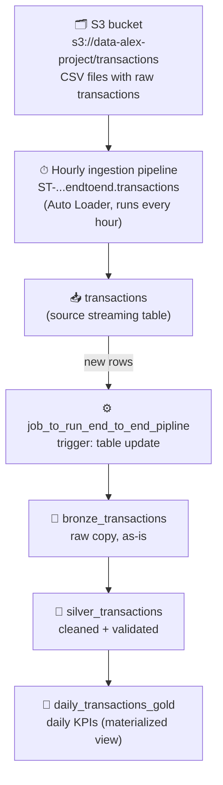

# End-to-End Transactions ETL Pipeline (Bronze → Silver → Gold)

A Lakeflow Spark Declarative Pipeline that turns raw transaction records into clean, analysis-ready data and daily business metrics, following the medallion architecture.

> **What makes this project different:** it answers *sales* questions — how much is sold each day, to how many customers, at what average order value. See the sibling project `user-signups-etl` for the *marketing* version (which days and channels bring signups).

## Pipeline Diagram

## The Tables (the solution)

The pipeline publishes three Unity Catalog tables in `first_project_alex_the_engineer.endtoend`. Each layer is a visible, queryable solution artifact — not just code.

### 🥉 `bronze_transactions` — streaming table, raw data preserved

Column-for-column copy of the source, untouched, so every downstream number can be traced back to what actually arrived.

| Column | Type | Notes |
| --- | --- | --- |
| transaction_id | STRING | raw, may contain spaces/casing noise |
| transaction_date | TIMESTAMP | |
| customer_id | STRING | raw |
| product_id | STRING | raw |
| product_name | STRING | e.g. `' T-SHIRT'`, `'pHONE cHARGER'` |
| category | STRING | raw |
| quantity | BIGINT | |
| unit_price | DOUBLE | unrounded |
| total_amount | DOUBLE | unrounded |
| store_location | STRING | raw |
| payment_method | STRING | raw |
| _rescued_data | STRING | all null — dropped in silver |

### 🥈 `silver_transactions` — streaming table, cleaned and validated

Same shape, but every value is trustworthy:

| Change | Example |
| --- | --- |
| IDs trimmed + uppercased | `' t-100 '` → `'T-100'` |
| Text trimmed, whitespace collapsed, title-cased | `'pHONE cHARGER'` → `'Phone Charger'` |
| Amounts rounded to 2 decimals | `12.345678` → `12.35` |
| `_rescued_data` removed | — |

Quality rules enforced on every run: **fail** on null IDs, **drop** rows with `quantity < 1` or `unit_price <= 0`, **warn** when `total_amount ≠ quantity × unit_price`.

### 🥇 `daily_transactions_gold` — materialized view, daily business KPIs

One row per calendar day — this is what a dashboard or report would read:

| Column | Type | Meaning |
| --- | --- | --- |
| transaction_day | DATE | calendar day |
| transaction_count | BIGINT | transactions that day |
| unique_customers | BIGINT | distinct buyers that day |
| total_units_sold | BIGINT | items sold that day |
| total_revenue | DOUBLE | revenue that day |
| avg_order_value | DOUBLE | average transaction value |

Sample of the actual output:

| transaction_day | transaction_count | unique_customers | total_units_sold | total_revenue | avg_order_value |
| --- | --- | --- | --- | --- | --- |
| 2025-01-06 | 14 | 14 | 49 | 1549.84 | 110.7 |
| 2025-01-15 | 10 | 10 | 31 | 858.58 | 85.86 |
| 2025-01-25 | 9 | 9 | 29 | 1518.24 | 168.69 |

## Implementation

| Layer | File | Type | What it does |
| --- | --- | --- | --- |
| Bronze | `transformations/bronze/bronze_transactions.py` | Streaming table | Streams the source table as-is |
| Silver | `transformations/silver/silver_transactions.py` | Streaming table | Normalizes IDs, text, amounts; enforces quality expectations |
| Gold | `transformations/gold/daily_transactions_gold.py` | Materialized view | Aggregates silver into daily KPIs (clustered by `transaction_day`) |

## Deployment

The `deployment/` folder exports the real Databricks-side configuration (which normally lives only in the workspace, not in code):

| File | What it captures |
| --- | --- |
| `deployment/pipeline.json` | The actual pipeline definition: publishing catalog/schema, serverless + Photon, library glob, pipeline ID |
| `deployment/job.json` | The actual job: table-update trigger on the source table, queueing, and the pipeline task |

Together with the source ingestion (an hourly scheduled streaming table created by the file-upload UI), these define the full automated chain: **S3 → source table → job trigger → pipeline → bronze → silver → gold**.

## Validation and Reliability

- `expect_or_fail` — run fails if `transaction_id`, `customer_id`, or `product_id` is null.
- `expect_or_drop` — rows with `quantity < 1` or `unit_price <= 0` are dropped.
- `expect` (warn) — flags rows where `total_amount` deviates from `quantity × unit_price` by more than a cent.

Operational lessons baked into the design:

- When a pipeline's publishing catalog changes, its internal tables must be cleaned up first, or initialization fails with cross-catalog permission errors.
- Hidden internal tables (`__materialization_*`, event logs) are invisible in Catalog Explorer but must be accounted for during cleanup.

## Results

On the sample dataset (Jan 6–26 2025), the gold layer produces 21 daily rows with consistent counts, revenue, and average order value per day.

## Reproduction Guide

1. Create a Lakeflow Spark Declarative Pipeline pointing at the `transformations/` folder (glob: `transformations/**`), publishing to a Unity Catalog catalog/schema — see `deployment/pipeline.json`.
2. Ensure the source streaming table `transactions` exists (created via file upload / Auto Loader from S3).
3. Create a job with a **table update trigger** on the source table so every new ingestion automatically refreshes bronze → silver → gold — see `deployment/job.json`.

**Technologies:** Databricks Lakeflow, PySpark, Delta Lake, Unity Catalog, Auto Loader, AWS S3, Jobs.
