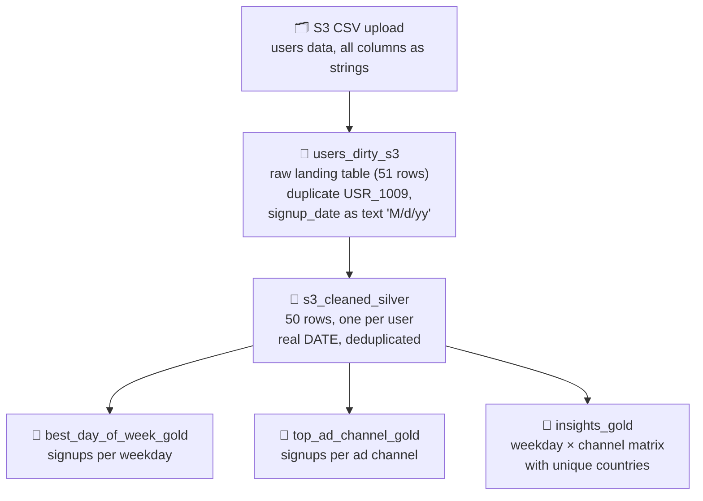

# Bronze to Silver to Gold ETL Pipeline (Users / Signups)

A Lakeflow Spark Declarative Pipeline that cleans a messy S3 user-signup dataset and produces marketing insight tables, following the medallion architecture. Published to Unity Catalog schema `first_project_alex_the_engineer.video1`.

> **What makes this project different:** it answers *marketing* questions — which days of the week and which ad channels bring the most signups, and from which countries. See the sibling project `sales-transactions-etl` for the *sales* version (daily revenue and order KPIs).

## Pipeline Diagram

## The Tables (the solution)

### 🥉 `video1.users_dirty_s3` — bronze, raw as loaded

All columns are strings; 51 rows including one duplicate (`USR_1009`); `signup_date` is text like `'8/1/23'` (one row uses `'2.29.24'` with dots).

### 🥈 `video1.s3_cleaned_silver` — materialized view, cleaned users

| Column | Type | Cleaning applied |
| --- | --- | --- |
| user_id | STRING | deduplicated (one row per user) |
| first_name | STRING | — |
| last_name | STRING | — |
| email | STRING | — |
| signup_date | DATE | `'2.29.24'`-style text standardized and parsed (`M/d/yy`) |
| country | STRING | — |
| referral_source | STRING | — |

Quality: `expect_or_fail` — the update fails if any `signup_date` fails to parse; `_rescued_data` helper column dropped.

### 🥇 Gold tables — the business answers

**`video1.best_day_of_week_gold`** — which weekdays bring the most signups:

| Column | Type | Meaning |
| --- | --- | --- |
| day_of_week | STRING | weekday name |
| total_signups | BIGINT | signups that weekday |
| pct_of_signups | DOUBLE | share of all signups (%) |

Actual output: Thursday 14 (28%), Tuesday 9 (18%), Monday 7, Sunday 7, Saturday 5, Friday 4, Wednesday 4.

**`video1.top_ad_channel_gold`** — which ad channels drive the most signups:

| Column | Type | Meaning |
| --- | --- | --- |
| referral_source | STRING | channel name |
| total_signups | BIGINT | signups from that channel |
| pct_of_signups | DOUBLE | share of all signups (%) |

Actual output: social_media 14 (28%), organic 11 (22%), referral 9 (18%), google_ads 8 (16%), partner 8 (16%).

**`video1.insights_gold`** — combined view, signups and reach per weekday × channel:

| Column | Type | Meaning |
| --- | --- | --- |
| day_name | STRING | weekday name |
| referral_source | STRING | channel name |
| signups | BIGINT | signups for that weekday × channel |
| unique_countries | BIGINT | distinct countries in that group |

Sample rows: Thursday × referral → 4 signups / 3 countries; Monday × social_media → 3 / 3; Thursday × organic → 3 / 3.

## Implementation

| Stage | File (this repo) | Source in Databricks |
| --- | --- | --- |
| Bronze → Silver | `transformations/bronze_to_silver.py` | Notebook `bronze to silver transformation` |
| Silver → Gold | `transformations/silver_to_gold.py` | Notebook `silver to gold transformation` |

## Deployment

| File | What it captures |
| --- | --- |
| `deployment/pipeline.json` | The real pipeline definition: publishing catalog/schema (`video1`), serverless + Photon, library glob, pipeline ID |

No separate orchestration job — the pipeline runs are started manually or from the pipeline UI; the source table is refreshed by the S3 file upload flow.

## Validation and Reliability

- `expect_or_fail("valid_signup_date")` — fails the update if any signup date does not parse.
- Deduplication guaranteed by `dropDuplicates(["user_id"])`.
- Cross-checks: sum of signups across both gold tables equals 50 (every user counted exactly once); 7 weekdays; 5 channels.

## Reproduction Guide

1. Upload the users CSV from S3 (`users_dirty_s3` bronze table, all-string columns).
2. Create a Lakeflow pipeline with the `transformations/` notebooks (glob `transformations/**`), publishing to `first_project_alex_the_engineer.video1` — see `deployment/pipeline.json`.
3. Run the pipeline; the silver and gold tables are created/refreshed automatically.

**Technologies:** Databricks Lakeflow, PySpark, Delta Lake, Unity Catalog, AWS S3.
